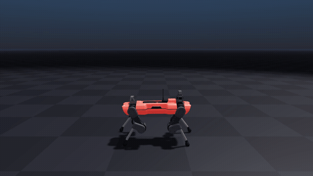

# newton-metal

**Robot reinforcement learning on an Apple-silicon Mac, with Newton physics on the GPU.**

Train a quadruped to walk **from scratch with PPO, entirely on a Mac GPU**: [Newton](https://github.com/newton-physics/newton) physics (MuJoCo Warp solver) running on Apple Metal through [warp-metal](https://github.com/innate-inc/warp-metal), with the learning done by PyTorch on MPS. No CUDA, no cloud.

> This is an independent project. It is not affiliated with or endorsed by the Newton project, NVIDIA, Apple or ANYbotics; it builds on their open-source work (see [ATTRIBUTION.md](ATTRIBUTION.md)).

> **Status: early and ongoing.** Walking is reproducible and measured. Jumping is experimental and only partly working, manipulation does not work yet, and several Newton examples still fail on Metal. See [docs/known-gaps.md](docs/known-gaps.md) for the full list. All results are single-seed.

## What works

ANYmal C velocity tracking on flat ground, command 0.8 m/s forward, 64 envs, 10 s, deterministic policy, Apple M5 Pro:

| | v1 | v2 | **v3 (shipped)** |
|---|---|---|---|
| Fall rate | 0% | 0% | **0%** |
| Forward speed (cmd 0.8) | 0.78 | 0.77 | **0.76 m/s** |
| Lateral drift over 10 s | 2.34 m | 0.58 m | **0.03 m** |
| Yaw-rate bias | +0.050 | +0.018 | **-0.006 rad/s** |
| Base height | 0.376 m | 0.530 m | **0.518 m** |
| Hind feet lift? | n/a | no (dragged) | **yes, symmetric trot** |

Training the shipped policy: 4096 envs, 1000 PPO updates, 98.3M env-steps in about 38 minutes (roughly 40-50k env-steps/s including learning). `docs/results.md` has the full table and how each fix was found.

## Quickstart (macOS, Apple silicon)

Tested with Python 3.14.7, `warp-metal` 1.17.0.4 (see below), `mujoco-warp` 3.17.0, torch 2.15.

    python -m venv .venv && source .venv/bin/activate
    pip install -r requirements.txt
    # Newton: until the Metal changes are upstream, use this branch (3 small commits on top of upstream main)
    git clone -b metal-float32-inertia https://github.com/hiteshK03/newton && pip install -e "./newton[sim,importers]"

    python scripts/eval_walk.py        # expect: 64/64 survive, ~0.76 m/s, ~0.03 m drift
    python scripts/render_walk.py      # writes media/anymal_walk.mp4

    # train your own (writes to the path you give; the shipped checkpoint is never overwritten by default runs)
    python -m nmrl.ppo_walk 4096 1000 checkpoints/my_walk.pt

## Metal-specific pieces (what is not stock)
Two things in the install differ from the upstream projects, and both are temporary:

- **`warp-metal` 1.17.0.4** (a wheel from `hiteshK03/warp-metal`, built from the `metal-df64` branch of [`hiteshK03/warp`](https://github.com/hiteshK03/warp), commit `09ce730b`). innate-inc's released 1.17.0.3 has no `fixedarray_t` on Metal, which Newton's contact code needs. The same change is open as pull requests on `innate-inc/warp` (#21, #22). That branch also contains an experimental float64 emulation (df64) that this project does **not** use.
- **Newton branch `metal-float32-inertia`** (`hiteshK03/newton`). Three commits on upstream `main`: GJK/MPR scratch buffers that work on Metal, a Metal-compatible native snippet, and float32 in the inertia inverse and eigendecomposition. Apple GPUs have no float64, and for ANYmal the float32 result matches the float64 build to 6e-7 relative (mass and validated inertia bit-identical; walking evaluation unchanged). Not tested: robots with inertia entries below about 1e-12.

Nothing here needs a float64 emulation at runtime.

## How it works
One GPU-resident environment: observations, rewards and resets are Warp kernels (one thread per env). Only the actions and the `done` flags cross the host/device boundary each step. See [`docs/how-it-works.md`](docs/how-it-works.md).

## Upstream Newton examples on Metal

We ran 20 examples from Newton's own `newton.examples` headless on `metal:0` with `--test` (the example's built-in success criteria), using unmodified example code. Apple M5 Pro, Newton branch above, warp-metal 1.17.0.4. **11 pass.** Clips (1080p, 10 s each; rendered with `scripts/render_example.py`) are in [`media/examples/`](media/examples/), and all of them plus the walking clip play together in [`media/montage.mp4`](media/montage.mp4) (`scripts/make_montage.py`).

| Result | Examples |
|---|---|
| Pass (11) | `basic_shapes`, `basic_joints`, `newton_cradle`, `pyramid`, `robot_cartpole`, `robot_g1`, `robot_anymal_d`, `robot_allegro_hand`, `robot_ur10`, `ik_franka`, `cloth_hanging` |
| Fail the same on CPU, so not Metal-specific (2) | `basic_urdf`, `robot_h1` |
| Float-noise tolerance (1) | `basic_pendulum`: Metal and CPU agree on position to 5 digits; out-of-plane velocity noise is ~1e-4 vs a 1e-4 test threshold |
| Needs CUDA by design (2) | `robot_panda_hydro` (SDF texture build), `mujoco_sleeping` |
| Metal gaps (3) | `ik_h1`, `mpm_granular` (float64 kernels; Metal has no float64), `cable_pile` (MSL compile error: "reference type must have explicit address space qualifier") |
| Not run (1) | `robot_anymal_c_walk` needs the `warp_nn` package, not installed here |

A pass means the example's own test completed; it is not a performance or accuracy comparison against CUDA. Single machine, single run.

## Related work
This project builds on [innate-inc/warp-metal](https://github.com/innate-inc/warp-metal). Another independent Metal backend for Warp exists at [APX103/warp-metal](https://github.com/APX103/warp-metal). Details in [ATTRIBUTION.md](ATTRIBUTION.md).

## Experimental: jumping (`experiments/jump/`)
We tried to teach a high jump and a long jump. Honest summary:
- Reward-only jumping hit **four reward exploits** (sitting on the belly, tucking during the spawn drop, ...). Write-up: [`docs/reward-exploits.md`](docs/reward-exploits.md).
- A hand-built reference with four imitation tricks (state initialisation, early termination, failure-point resets, a joint reference) was a **null result**: no arm learned to jump in 300 updates.
- After adding a flight-timing reward and a distance-scale curriculum, one run produced real single jumps (up to 0.56 m forward vs a 0.72 m target; 100% success at half size, 0% at full size under a strict test). One seed; the walking skill is probably lost in that checkpoint (not tested). Details and caveats: [`experiments/jump/README.md`](experiments/jump/README.md).

This is not a replication of SuperMimic or BlinkMimic. Porting a mimic-style tracker to Newton-on-Metal is a roadmap item, see [CONTRIBUTING.md](CONTRIBUTING.md).

## Layout
    nmrl/            environments and PPO (walk: anymal_walk_env.py, ppo_walk.py; experimental: anymal_multi_env.py, ppo_multi.py)
    scripts/         eval / diagnose / render the walking policy; render_example.py renders any upstream Newton example
    experiments/jump reference generation, curriculum, ablation, evals
    checkpoints/     shipped walking policy (0.5 MB); experimental ones under experimental/
    docs/            how-it-works, results, reward-exploits, notebook (raw lab notes)
    media/           GIFs; media/examples/ clips of upstream Newton examples running on Metal

## Credits
Built on NVIDIA Warp, warp-metal (by David Dobas, developed at innate-inc), Newton, MuJoCo Warp and PyTorch. Full list with licences and links: [`ATTRIBUTION.md`](ATTRIBUTION.md). Developed with Claude Code and the Hermes agent.

## Limitations
Single seed. Flat ground only. Simulation only; no sim-to-real. Full list of what is missing or unproven (float64, CUDA-only paths, unmerged Newton changes, manipulation): [docs/known-gaps.md](docs/known-gaps.md). The ANYmal model is downloaded at runtime from Newton's assets (not redistributed here).

## Licence
Apache-2.0, see [LICENSE](LICENSE) and [NOTICE](NOTICE).
