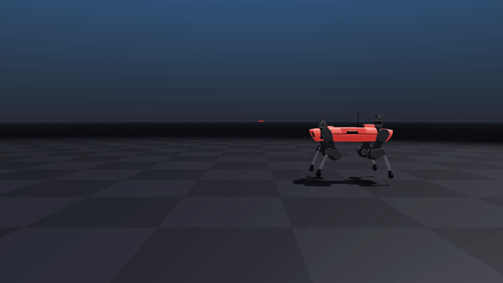

# Experimental: jumping

**Status: partly working, single seed, not a finished result.** Treat everything here as a lab notebook.

## Files
- `gen_long_jump_ref.py` -> builds the kinematic reference (root path: crouch, thrust, ballistic flight, landing). `../../media/long_jump_reference.png` shows it.
- `calib_crouch.py`, `build_joint_ref.py` -> crouch-to-joint map and joint reference (needs the simulator).
- `replay_ref.py` -> open-loop replay of the joint reference (feasibility check).
- `../../nmrl/anymal_multi_env.py`, `ppo_multi.py` -> multi-skill env with switchable tricks (`REF_RSI`, `REF_ET`, `REF_FPR`, `REF_JREF`, `LAM_MIN/MAX`, `FORCE_SKILL`, `LAUNCH_P`).
- `run_ablation.sh`, `run_curriculum.sh`, `eval_ref.py`, `eval_curr.py`, `eval_multi.py`, `render_curr.py`.

## Reproduce the headline eval (shipped experimental checkpoint)
    python experiments/jump/eval_curr.py checkpoints/experimental/long_jump_C3.pt 0.5

## What this checkpoint is and is not
- Trained on the long-jump skill only (final stage of the curriculum). The walking and high-jump skills are probably lost; this was not tested.
- Success rule (strict): upright to the end, a real flight after first ground contact covering at least half the scaled reference flight, and at least 70% of the scaled forward distance at 2.0 s.
- The scripts were ported from a working directory; `run_*.sh` have not been re-run since the move.

See `docs/reward-exploits.md` and `docs/results.md` for what went wrong along the way.
